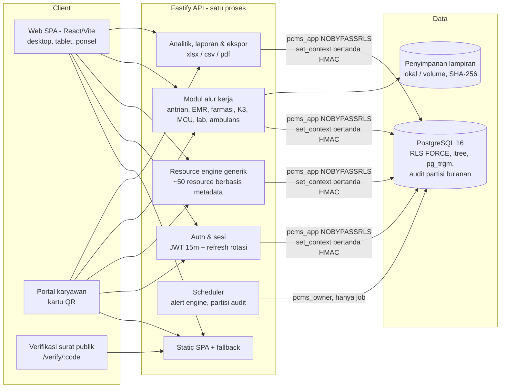
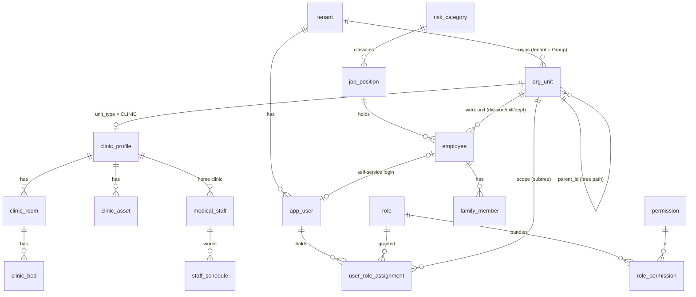
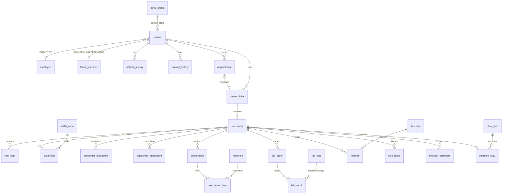
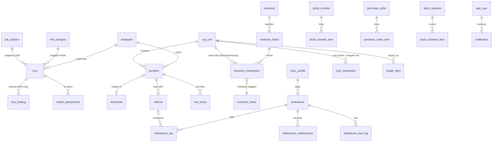

# Palmora Health (PCMS — Plantation Clinic Management System)
## Blueprint Arsitektur & Implementasi (Phase 1–12)

> Dokumen ini berisi analisis kebutuhan, arsitektur, skema database, ERD, RBAC, strategi tenant isolation, struktur API, struktur proyek, navigasi UI, roadmap, serta status implementasi. Ke-12 phase sudah diimplementasikan dan diuji otomatis (§10–§11). Bagian yang masih berupa rancangan atau batasan yang diketahui ditandai eksplisit (§6.2 dan §11.5).

---

## 1. Analisis Kebutuhan

### 1.1 Konteks bisnis
Grup perkebunan kelapa sawit memiliki struktur organisasi yang dalam dan berubah-ubah (akuisisi PT baru, pemekaran region, estate pindah region). Klinik berada di estate dan mill, melayani karyawan (mayoritas pekerja lapangan berisiko tinggi), keluarga, kontraktor, dan tamu. Ada tiga kepentingan yang sering bertabrakan:

| Kepentingan | Butuh | Risiko jika salah desain |
|---|---|---|
| **Klinis** (dokter, perawat, apoteker) | Rekam medis lengkap, cepat, lintas klinik saat pasien dirawat | Kebocoran data medis, rekam medis terfragmentasi |
| **Operasional/HR/HSE** | Status administratif: sakit/izin, fit/unfit, kecelakaan, lost time | HR melihat diagnosis (pelanggaran kerahasiaan medis) |
| **Manajemen korporat** | KPI agregat, tren, biaya, early warning per PT/estate | Dashboard bocor ke data per-pasien |

### 1.2 Persona utama
Super Admin, Group Admin, Corporate Management, Medical Director, Medical Manager, HR Manager/Officer, HSE Manager/Officer, PT Admin, Estate Manager, Clinic Manager, Doctor, Nurse, Pharmacist, Medical Record Officer, Finance, Ambulance Driver, Employee/Patient (self-service).

### 1.3 Kebutuhan fungsional → modul
| # Kebutuhan | Modul sistem | Tabel inti (Phase 1) |
|---|---|---|
| 1, 4 Organisasi dinamis | `ORGANIZATION` | `tenant`, `org_unit` (ltree), `org_unit_type`, `org_unit_type_rule`, `clinic_profile` |
| 2, 3, 25 Multi-tenant, RBAC, privasi | `USER_ADMIN` + RLS | `app_user`, `role`, `permission`, `role_permission`, `user_role_assignment`, `user_session` |
| 5 Karyawan & keluarga | `EMPLOYEE` | `employee`, `family_member`, `job_position`, `risk_category` |
| 6, 9 Pasien, appointment, antrian | `PATIENT`, `APPOINTMENT`, `QUEUE` | `patient`, `appointment`, `queue_ticket`, `staff_schedule`, `clinic_schedule_exception` |
| 7 EMR | `EMR` | `encounter` (=MedicalRecord), `vital_sign`, `diagnosis`, `encounter_procedure`, `encounter_addendum`, `patient_allergy`, `patient_history`, `attachment` |
| 8 Manajemen klinik | `CLINIC` | `clinic_profile`, `clinic_room`, `clinic_bed`, `clinic_asset`, `medical_staff`, `inpatient_stay` |
| 10 Kesehatan kerja | `OCC_HEALTH` | `mcu`, `mcu_finding`, `health_assessment`, `v_employee_health_status` |
| 11 Kecelakaan | `ACCIDENT` | `accident`, `workflow_event` |
| 12 Rujukan | `REFERRAL` | `referral`, `hospital` |
| 13, 14 Farmasi & multi-klinik | `PHARMACY`, `INVENTORY` | `medicine`, `medicine_batch`, `inventory_stock`, `inventory_transaction`, `inventory_level`, `purchase_order*`, `stock_transfer*`, `stock_opname*`, `prescription*` |
| 15 Laboratorium | `LAB` | `lab_test`, `lab_order`, `lab_result` |
| 16 Ambulans | `AMBULANCE` | `ambulance`, `ambulance_trip`, `ambulance_maintenance`, `ambulance_fuel_log` |
| 17 Surat sakit & sertifikat | `SICK_LEAVE` | `sick_leave`, `medical_certificate` |
| 18–21 Analitik & dashboard | `DASHBOARD`, `ALERT` | `health_alert` (agregat dihitung langsung oleh fungsi `analytics.*`) |
| 22 Keuangan | `FINANCE` | `cost_transaction` |
| 23 Laporan | `REPORT` | 15 laporan berbasis query ber-RLS (`apps/api/src/modules/reports.ts`) |
| 24 Audit | `AUDIT` | `audit.audit_log` (partisi bulanan) |
| 26 Notifikasi | `NOTIFICATION` | `notification` |
| 27 QR | lintas modul | kolom `qr_token` di employee, patient, medicine, clinic_asset, ambulance; `verification_code` di sertifikat |
| 28 Global search | lintas modul | indeks `pg_trgm` + RLS (lihat §6.6) |

### 1.4 Kebutuhan non-fungsional
- **Keamanan & privasi:** isolasi tenant di level database, need-to-know untuk data klinis, audit lengkap, tidak ada hard delete rekam medis. Mengacu UU No. 27/2022 (Pelindungan Data Pribadi) dan Permenkes No. 24/2022 (Rekam Medis Elektronik: wajib disimpan, dapat diaudit, kerahasiaan).
- **Skalabilitas:** puluhan Group, ratusan PT/estate, ribuan klinik, jutaan encounter. Penambahan unit = data, bukan kode.
- **Ketersediaan di lapangan:** koneksi estate sering buruk → UI ringan & responsif (SPA, aset di-cache permanen); mode offline/PWA belum dibangun (§11.5).
- **Maintainability:** satu bahasa (TypeScript) di backend & frontend, skema dikelola migrasi berversi, aturan keamanan terpusat di database.

### 1.5 Keputusan desain kunci (dan alasannya)
| Keputusan | Alasan |
|---|---|
| **Satu tabel `org_unit` + `ltree`** (bukan tabel per level) | Hirarki bisa berbeda per PT (ada yang pakai Region, ada yang tidak; mill di bawah estate atau langsung di PT). Aturan parent→child disimpan sebagai data (`org_unit_type_rule`). Query "semua di bawah Estate X" = satu operator `<@` ber-indeks GiST. View `v_company`, `v_estate`, dst. tetap menyediakan entitas terpisah sesuai spesifikasi. |
| **Tenant = Group**, shared database + shared schema + `tenant_id` + **Row-Level Security** | Biaya operasional rendah untuk banyak Group, satu kali migrasi. Karena skema identik, Group besar bisa dipindah ke database sendiri (model *silo*) tanpa ubah kode. |
| **RLS sebagai lapisan otoritatif** | Endpoint yang bug, query laporan yang ditulis manual, job ekspor — semuanya tetap tidak bisa membaca di luar scope. Frontend hanya kosmetik. |
| **Scope = subtree org_unit** pada setiap role assignment | Satu user bisa Doctor di Klinik A sekaligus Clinic Manager di Klinik B. Scope di PT otomatis mencakup semua estate & klinik di bawahnya — termasuk yang ditambah kemudian. |
| **Pemisahan tabel administratif vs klinis** | `sick_leave`, `medical_certificate`, `mcu`, `health_assessment` secara struktural **tidak punya kolom diagnosis**. HR tidak bisa "tidak sengaja" melihatnya karena datanya memang tidak ada di tabel itu. |
| **Stok = turunan dari transaksi append-only** | Tidak ada update stok manual; setiap mutasi tercatat; saldo selalu bisa direkonstruksi. |
| **Modular monolith** (bukan microservices di awal) | Tim kecil-menengah, transaksi lintas modul (resep → stok → biaya) butuh konsistensi ACID. Batas modul dijaga di kode sehingga bisa dipecah nanti. |

---

## 2. Arsitektur Sistem

> **Perubahan dari blueprint awal.** Rencana Phase 1 menyebut NestJS + Next.js. Implementasi memakai
> **Fastify + TypeScript** (API) dan **Vite + React SPA** (web) yang disajikan oleh API yang sama sebagai
> *satu deployable*. Alasannya: (1) seluruh otorisasi data sudah berada di PostgreSQL (RLS), sehingga
> lapisan guard/DI NestJS tidak menambah keamanan, hanya kompleksitas; (2) `withContext` membutuhkan
> kontrol transaksi eksplisit per request — lebih sederhana di Fastify + `pg`; (3) aplikasi ini adalah
> aplikasi internal ber-login (tidak butuh SSR/SEO), jadi SPA statis lebih murah dioperasikan
> (satu proses Node, tanpa server render). Struktur modul tetap modular-monolith dan dapat dipecah.



### 2.1 Stack teknologi (terimplementasi)
| Lapisan | Pilihan | Catatan |
|---|---|---|
| Database | **PostgreSQL 16** (+ `ltree`, `pg_trgm`, `pgcrypto`, `citext`, `btree_gist`) | RLS *forced* di semua tabel tenant, audit trigger, workflow guard, analitik `SECURITY DEFINER` dengan cek izin |
| Backend | **Fastify 5 + TypeScript** (tsx), `pg`, **Zod 4** | Setiap request = satu transaksi `withContext`; error PostgreSQL dipetakan ke HTTP |
| Auth | Argon2id (`@node-rs/argon2`), JWT HS256 (jose) 15 menit, refresh token opak (SHA-256 di DB) dengan rotasi & deteksi reuse, idle timeout 30 menit, TOTP MFA (otplib), lockout 5× | Rate limit login 10/menit per IP |
| Enkripsi | AES-256-GCM tingkat kolom (`enc:v1:`) untuk catatan rahasia dokter & secret MFA | Kunci `FIELD_ENCRYPTION_KEY`; produksi menolak start tanpa kunci |
| Frontend | **React 18 + Vite 5**, Tailwind 3, TanStack Query 5, React Router 6, ECharts, lucide | Halaman generik digerakkan metadata `GET /meta/resources` + halaman alur kerja khusus |
| Laporan | ExcelJS, CSV, PDFKit; QR via `qrcode` | Semua unduhan dicatat `EXPORT`/`PRINT` di audit |
| Job | Scheduler in-process (alert engine 15 menit, partisi audit bulanan) | `JOBS_ENABLED=false` untuk replika API tambahan |
| Deployment | Satu proses Node (API + SPA) di belakang reverse proxy TLS; PostgreSQL terkelola dengan PITR | Skala horizontal: beberapa instance API stateless, job hanya di satu instance |

### 2.2 Siklus hidup request (pola wajib)
```ts
// apps/api/src/core/db.ts
export async function withContext<T>(ctx: RequestContext, fn: (tx: Tx) => Promise<T>) {
  const client = await pool.connect();          // pool login sebagai pcms_app (NOBYPASSRLS)
  await client.query('BEGIN');
  // konteks ditandatangani HMAC di DB; tenant diturunkan dari user, bukan dari klien
  await client.query('SELECT app.set_context($1, $2, $3, $4)', [ctx.userId, ctx.ip, ctx.userAgent, ctx.requestId]);
  const r = await fn(wrap(client));              // semua query setelah ini otomatis dibatasi RLS
  await client.query('COMMIT');
  return r;
}
```
`requirePerm(tx, 'EMR', 'READ')` di API memberi pesan 403 yang jelas dan menolak lebih awal; **keputusan akhir tetap di RLS**
(uji `02-access` membuktikan endpoint menolak meski menu disembunyikan). Kegagalan keamanan yang harus tersimpan
(hitungan login gagal, pencabutan token karena reuse) dikembalikan sebagai data dari transaksi lalu dilempar setelah COMMIT.

---

## 3. Skema Database ✅ Terimplementasi

**71 tabel, 12 view, 221 policy RLS, 198 trigger** dalam 10 migrasi berversi (`packages/db/migrations`).

| Migrasi | Isi |
|---|---|
| `0001_foundation` | Schema `app` & `audit`, konteks request, trigger kolom standar, audit trail terpartisi, larangan hard delete, `app.log_access()` |
| `0002_organization` | `tenant`, `org_unit` (ltree, validasi tipe, pindah subtree), `clinic_profile`, ruang, bed, aset klinik, view entitas |
| `0003_iam` | Konteks bertanda tangan HMAC, permission, role, user, assignment ber-scope, `unit_ids()`, `set_context()`, fungsi login, anti-eskalasi, generator policy |
| `0004_hr_patient` | Risiko kerja, jabatan, karyawan (PT/estate diturunkan otomatis), keluarga, pasien, alergi, riwayat |
| `0005_clinical` | ICD-10, tenaga medis, jadwal, appointment, antrian, encounter (kunci setelah ditandatangani), tanda vital, diagnosis, tindakan, addendum, rawat inap, laboratorium (flag otomatis), lampiran |
| `0006_pharmacy_inventory` | Katalog obat, batch & kedaluwarsa, stok per site, transaksi append-only, PO, transfer antar klinik, stock opname, resep |
| `0007_occupational_operations` | Rumah sakit, MCU & temuan, health assessment, kecelakaan, rujukan, ambulans, surat sakit, sertifikat, `v_employee_health_status` |
| `0008_finance_notification` | Biaya, health alert, notifikasi, penomoran dokumen, workflow event |
| `0009_security_policies` | 23 modul × 7 aksi = 161 permission; RLS untuk seluruh tabel; *care relationship* |
| `0010_system_roles` | 19 role sistem + matriks permission |

### 3.1 Konvensi
- **PK UUID** (`gen_random_uuid()`) di semua tabel bisnis; aman untuk sinkronisasi offline & merge antar database.
- **Kolom standar** di setiap tabel bisnis: `tenant_id, created_at, created_by, updated_at, updated_by, version, deleted_at, deleted_by` — diisi oleh trigger `_std_columns` (tidak bisa dipalsukan API). `version` untuk optimistic locking.
- **Validasi di database**: CHECK untuk enum/format (NIK 16 digit, BPJS 13 digit, plat nomor, rentang tanda vital, konsistensi status↔tanggal), FK, unique parsial. API menambah validasi Zod untuk pesan yang ramah.
- **Soft delete**: menghapus = mengisi `deleted_at`, butuh permission `DELETE` (dicek trigger). Tabel klinis & legal diberi trigger `_no_delete` yang menolak `DELETE` fisik — bahkan untuk owner database.
- **Rekam medis bertanda tangan bersifat final**: koreksi lewat `encounter_addendum`.
- **Penomoran dokumen** bebas celah & aman konkuren: `app.next_document_no('ACC','SNL','YYYY')` → `ACC-SNL-2026-000123`.

---

## 4. Entity Relationship

### 4.1 Organisasi, akses, karyawan


### 4.2 Pelayanan klinis


### 4.3 Kesehatan kerja, K3, farmasi, operasional


**Rantai kesehatan kerja (Kebutuhan #10):** `employee → job_position → risk_category → mcu (+ mcu_finding) → health_assessment → fit status`, disajikan siap pakai oleh view `v_employee_health_status` (status kepatuhan MCU: `UP_TO_DATE / DUE_SOON / OVERDUE / NEVER_EXAMINED`).

---

## 5. RBAC ✅ Terimplementasi

### 5.1 Model
```
permission  = (module, action)          23 modul × {CREATE, READ, UPDATE, DELETE, APPROVE, EXPORT, PRINT}
role        = kumpulan permission       19 role sistem (tenant_id NULL) + role kustom per tenant
assignment  = user × role × scope       scope = org_unit, berlaku untuk seluruh subtree-nya
```
Semua pemeriksaan bermuara ke satu fungsi: **`app.unit_ids(module, action)`** → daftar org unit tempat user boleh melakukan aksi itu. Di policy ditulis `kolom_unit = ANY ((SELECT app.unit_ids('EMR','READ'))::uuid[])`; sub-select skalar membuat PostgreSQL menghitungnya **sekali per statement** (InitPlan, diverifikasi oleh test).

### 5.2 Matriks role (ringkas)
`C R U D A E P` = Create Read Update Delete Approve Export Print. **Tebal** = modul klinis.

| Role | Scope tipikal | Permission utama |
|---|---|---|
| Super Admin | Group | Semua modul non-klinis CRUDAEP, AUDIT REP. *Tanpa akses rekam medis secara default.* |
| Group Admin | Group | ORGANIZATION, USER_ADMIN (+A), MASTER_DATA, CLINIC; AUDIT RE |
| Corporate Management | Group | DASHBOARD/REPORT REP, FINANCE REP, ALERT R, EMPLOYEE/INVENTORY/ACCIDENT/OCC_HEALTH R |
| Medical Director | Group | **EMR REP, LAB REP, PHARMACY R, REFERRAL RAEP**, OCC_HEALTH RUAEP, ACCIDENT RAEP, MASTER_DATA CRU (formularium) |
| Medical Manager | PT | Seperti Medical Director pada level PT |
| HR Manager | PT | EMPLOYEE CRUDEP, SICK_LEAVE RAEP, OCC_HEALTH REP (fit status saja) |
| HSE Manager | PT | ACCIDENT CRUDAEP, OCC_HEALTH CRUEP, EMPLOYEE R |
| PT Admin | PT | ORGANIZATION CRU, USER_ADMIN CRUA, EMPLOYEE CRUE |
| Estate Manager | Estate | DASHBOARD REP, EMPLOYEE/SICK_LEAVE/OCC_HEALTH/INVENTORY R, ACCIDENT RA |
| Clinic Manager | Klinik | CLINIC, QUEUE, APPOINTMENT CRUDEP, PATIENT CRUEP, INVENTORY CRUDAEP, AMBULANCE CRUDEP |
| Doctor | Klinik | **EMR CRUP, LAB CRUP, PHARMACY R, REFERRAL CRUP**, SICK_LEAVE CRUP, OCC_HEALTH CRUAP |
| Nurse | Klinik | **EMR CRU, LAB CR, REFERRAL R**, PATIENT/QUEUE/APPOINTMENT CRU, ACCIDENT CRU |
| Pharmacist | Klinik / Gudang | **PHARMACY CRUP**, INVENTORY CRUDAEP, PATIENT R |
| Medical Record Officer | Klinik | PATIENT CRUDEP, **EMR REP, LAB R** |
| HR Officer | Estate | EMPLOYEE CRU, SICK_LEAVE RA |
| HSE Officer | Estate | ACCIDENT CRUP, OCC_HEALTH R |
| Finance | PT | FINANCE CRUDAEP, INVENTORY R, DASHBOARD RE |
| Ambulance Driver | Klinik | AMBULANCE RU |
| Employee/Patient | Group | Portal self-service (data milik sendiri via fungsi `app.portal_*`) |

Matriks lengkap: `packages/db/migrations/0010_system_roles.sql`. Test memastikan **tidak ada role non-klinis yang memegang permission modul klinis**.

### 5.3 Aturan need-to-know
1. **Data klinis hanya di tabel klinis** (`encounter`, `diagnosis`, `mcu_finding`, `lab_result`, `referral`, `prescription`, `patient_history`). Tabel yang dibaca HR/HSE/manajemen tidak memiliki kolom diagnosis.
2. **Care relationship:** dokter melihat riwayat lengkap pasien dari klinik lain *hanya selama pasien sedang berkunjung* di kliniknya (tiket antrian ≤ 7 hari). Setelah itu akses gugur otomatis. Dokter tetap tidak bisa mengubah rekam medis klinik lain.
3. **Apoteker** melihat resep dan alergi (keamanan dispensing), tetapi tidak membuka SOAP/diagnosis.
4. **Dashboard manajemen** dilayani fungsi agregat `SECURITY DEFINER` dengan *small-cell suppression* (sel < 5 pasien disamarkan) agar tidak bisa di-drill ke individu tanpa permission EMR.
5. **Break-glass**: akses darurat ke rekam medis dengan alasan wajib, berlaku singkat, tercatat `BREAK_GLASS` di audit dan memicu notifikasi ke Medical Director.

### 5.4 Pengamanan administrasi akses
- Pemberi role harus memegang **semua** permission role tersebut pada scope target, **atau** memegang `USER_ADMIN:APPROVE` di scope itu (admin akses terdelegasi, mis. PT Admin meng-onboard dokter tanpa ia sendiri bisa membaca EMR).
- User tidak dapat mengubah role assignment miliknya sendiri.
- Role sistem tidak dapat diubah lewat API; role kustom hanya oleh pemegang `USER_ADMIN` di level Group.
- Assignment tidak pernah dihapus fisik (`revoked_at`), sehingga riwayat "siapa punya akses apa, kapan" selalu tersedia.

---

## 6. Strategi Tenant Isolation ✅ Terimplementasi (lapisan DB)

### 6.1 Model tenancy
*Pool model*: satu database, satu skema, setiap baris memiliki `tenant_id`. Tenant = Group/Holding. Group yang membutuhkan isolasi fisik (regulasi, ukuran) dapat dipindah ke database terdedikasi dengan skema & kode yang sama (*silo model*), dipilih lewat konfigurasi koneksi per tenant.

### 6.2 Defense in depth
| Lapisan | Mekanisme |
|---|---|
| **Database** ✅ | RLS `ENABLE + FORCE` di semua 63 tabel tenant + audit log; role API `pcms_app` `NOBYPASSRLS` dan bukan owner; tabel referensi global (ICD-10, permission) read-only |
| **Konteks request** ✅ | `app.set_context()` memvalidasi user aktif & tenant aktif, lalu menyimpan `user_id`, `tenant_id` + **tanda tangan HMAC** (secret hanya dapat dibaca owner). GUC yang dipalsukan lewat SQL injection tanpa tanda tangan valid diabaikan → nol baris |
| **Fail-closed** ✅ | Tanpa konteks, setiap tabel mengembalikan 0 baris (diuji untuk semua tabel) |
| **Integritas tulis** ✅ | `tenant_id` diisi trigger & immutable; parent org unit lintas tenant ditolak; assignment lintas tenant ditolak |
| **API** ✅ | `requirePerm` per endpoint, skema Zod tanpa `tenant_id` dari klien (diisi trigger), rate limit per token/IP (login 10/menit) |
| **Service/Query** ✅ | Seluruh route memakai `db(req, …)` → `withContext()`; pool owner (`ownerPool()`) hanya dipakai scheduler |
| **Laporan & ekspor** ✅ | Dijalankan dalam request pengguna (`withContext`) sehingga query laporan memakai `set_context(user)` yang sama dan tunduk RLS; setiap unduhan dicatat `EXPORT`/`PRINT`. (Rancangan untuk ekspor sangat besar: job antrian yang menyimpan `user_id` pemesan, file per tenant) presigned URL 10 menit; aksi `EXPORT` dicatat di audit |
| **Cache** | Tidak ada cache data di server (setiap query melewati RLS). Bila cache ditambahkan: key wajib diawali `tenant:{id}:user:{id}` |
| **File** ✅ | Lampiran: `owner_unit_id` + `module` menentukan visibilitas (RLS); berkas disimpan di luar web root, diunduh hanya lewat API dengan verifikasi SHA-256 |
| **Frontend** ✅ | Menu & tombol dari `app.my_permissions()`; hanya kosmetik |

### 6.3 Global search
Dilakukan di PostgreSQL (indeks `pg_trgm` pada nama pasien, karyawan, obat, unit) sehingga **otomatis mengikuti RLS** — test membuktikan query yang sama mengembalikan hasil berbeda untuk dokter, HR, dan manajemen. Jika kelak dipindah ke OpenSearch, setiap dokumen membawa `tenant_id` + `unit_path` dan filter wajib disuntikkan server-side.

---

## 7. Struktur API (terimplementasi)

REST JSON di bawah `/api/v1`. Semua endpoint (kecuali login/refresh/verifikasi publik) memerlukan `Authorization: Bearer`.

```
/auth            POST login · refresh · logout · password · mfa/setup · mfa/enable · mfa/disable · logout-all
                 GET  me · sessions          DELETE sessions/:id
/meta/resources  GET  metadata semua resource (kolom, field+validasi, filter, izin efektif user)
/r/:key          GET  list (q, filter, sort, page, unitId subtree)   POST create
/r/:key/:id      GET  detail (+transisi tersedia, riwayat workflow, lampiran)   PATCH (If-Match: version)   DELETE (soft / revoke)
/r/:key/:id/transition   POST {to, note, patch}  — validasi status asal→tujuan, izin APPROVE, four-eyes
/r/:key/export   GET  ?format=xlsx|csv|pdf
/lookup/:kind    GET  pilihan form (19 jenis) di bawah RLS
/org/tree        GET
/patients        GET lookup?q= (No. karyawan / NIK / No. RM / nama / telepon / QR)   POST register
/queue           GET board?clinicId=&date=   POST register · :id/transition · :id/triage
/emr             GET encounters/:id · patients/:id/timeline
                 POST encounters · :id/vitals · diagnoses · procedures · prescriptions (cek alergi) · lab-orders · referrals ·
                      sick-leave · certificates · sign · addenda · break-glass      PATCH encounters/:id
/lab             GET worklist   POST orders/:id/results · orders/:id/verify
/pharmacy        GET prescriptions · prescriptions/:id · stock · stock/summary · stock/:site/:medicine · transfers/:id ·
                     purchase-orders/:id · opnames/:id
                 POST prescriptions/:id/dispense (FEFO) · adjustments · write-off-expired · receipts · transfers (+approve/reject/ship/receive) ·
                      purchase-orders (+receive) · opnames (+post)    PATCH opnames/:id/counts
/occ-health      GET compliance · employees/:id · mcu/:id     POST mcu/schedule · mcu/:id/complete
/ambulance       POST dispatch
/dashboard       GET summary · trend · top-diseases · drilldown · clinic-performance · accidents · occupational · medicine · clinic-today
/finance         GET costs?dimension=category|company|estate|clinic|disease|employee|payer|month
/reports         GET (katalog 15 laporan + izin)   GET :code?unitId=&from=&to=&dimension=&format=json|xlsx|csv|pdf
/notifications   GET   POST :id/read · read-all
/search          GET ?q=  (seksi dibatasi izin; isi dibatasi RLS)
/qr              GET :kind/:id.png · resolve?code=
/files           POST (multipart, cek magic number, SHA-256)   GET :id/download (verifikasi hash)
/documents       GET sick-leave|certificate|referral/:id.pdf (dengan QR verifikasi)
/portal          GET summary · card.png   POST appointments   DELETE appointments/:id
/admin           POST users · users/:id/reset-password · users/:id/unlock · roles · jobs/alert-engine   GET roles   PUT roles/:id/permissions
/audit           GET ?q=&action=&userId=&table=&recordId=&from=&to=
/public/verify/:code   GET (tanpa login; nama disamarkan, tanpa diagnosis)
```

**Konvensi:** paginasi `?page=&pageSize=` (maks 200); `?unitId=` mencakup seluruh subtree; `If-Match: <version>` → 409 bila konflik;
format error seragam:
```json
{ "error": { "code": "PERMISSION_DENIED", "message": "Anda tidak memiliki izin …", "details": "…", "requestId": "…" } }
```

---

## 8. Struktur Folder / Proyek

```
pcms/                                   monorepo (npm workspaces)
├── docs/ARCHITECTURE.md                dokumen ini
├── packages/db/
│   ├── bootstrap.sql                   role pcms_owner / pcms_app + database
│   ├── migrations/0001…0018_*.sql      skema, RLS, role, layanan aplikasi, analitik, perbaikan
│   ├── seed/                           generator data demo deterministik
│   ├── scripts/                        migrate (checksum), reset
│   └── test/                           43 test keamanan & integritas (sebagai pcms_app)
└── apps/
    ├── api/                            Fastify + TypeScript
    │   ├── src/core/                   config, db (withContext), security, http, errors, time
    │   ├── src/modules/                auth · resources (+def, hooks) · lookups · clinical · pharmacy ·
    │   │                               operations (org, OH, ambulans, dashboard, finance, notifikasi, search, QR) ·
    │   │                               reports · export · platform (admin, audit, file, dokumen, portal, verifikasi)
    │   ├── src/jobs/scheduler.ts       alert engine & partisi audit
    │   └── test/                       46 test integrasi API (Fastify inject, DB nyata)
    └── web/                            React + Vite SPA
        └── src/
            ├── lib/                    api client (refresh otomatis), session & scope, format, meta
            ├── components/             Layout (sidebar, scope bar, search Ctrl K, notifikasi), DataTable,
            │                           ResourcePage/Form generik, RefSelect, Chart, ui
            └── pages/                  Login, Dashboard, Queue, Encounter, PatientTimeline, Pharmacy, Clinical
                                        (lab, MCU, ambulans, alert), Finance, Reports, Admin (audit, org,
                                        user, role), Profile, Portal (+verifikasi publik)
```

---

## 9. Navigasi UI

### 9.1 Gaya visual
Enterprise–medis–perkebunan: **Deep green** `#0F3D2E` (sidebar, header), primary `#1B6B4A`, aksen lembut `#C8A951` (emas sawit) untuk highlight/KPI, netral abu `#F5F7F6 / #E3E8E5 / #5B6B63`, putih untuk kanvas kerja. Status: hijau = normal, amber = MEDIUM, oranye = HIGH, merah = CRITICAL. Font IBM Plex Sans (+ Plex Sans Condensed untuk judul & angka KPI); angka tabular. Mode gelap opsional. Responsif: sidebar menjadi bottom-nav di mobile; tabel menjadi kartu.

### 9.2 Struktur layar
```
┌──────────────────────────────────────────────────────────────────────────┐
│ [Logo Palmora]  [Scope: SNG ▸ PT SNL ▸ Kebun Sei Rokan ▾]  [🔍 Cari...]  🔔 👤 │
├──────────────┬───────────────────────────────────────────────────────────┤
│ Dashboard    │  Breadcrumb · Filter: Periode · Unit                      │
│ Pelayanan    │  ┌KPI┐ ┌KPI┐ ┌KPI┐ ┌KPI┐ ┌KPI┐                            │
│  ├ Antrian   │  ┌──────── tren ────────┐ ┌── alert early warning ──┐   │
│  ├ Pasien    │  └──────────────────────┘ └─────────────────────────┘   │
│  ├ Rekam Medis│  ┌──── drill-down tabel (PT → Estate → Klinik) ────┐   │
│  └ Lab       │  └──────────────────────────────────────────────────┘   │
│ Farmasi      │                                                           │
│ Kesehatan Kerja                                                          │
│ K3 / Kecelakaan                                                          │
│ Rujukan · Ambulans · Surat Sakit                                         │
│ Keuangan · Laporan                                                       │
│ Master Data · Admin · Audit                                              │
└──────────────┴───────────────────────────────────────────────────────────┘
```
**Scope picker** di header hanya menampilkan unit yang ada di `my_permissions()`; seluruh halaman mengikuti scope terpilih.

### 9.3 Menu per role (default landing page)
| Role | Landing | Menu yang tampil |
|---|---|---|
| Corporate Mgmt / Super Admin | Corporate Dashboard | Dashboard, Alert, Keuangan, Laporan (+Admin, Audit untuk Super Admin) |
| Medical Director/Manager | Health Intelligence | Dashboard, Rekam Medis (baca), Kesehatan Kerja, K3, Rujukan, Farmasi, Laporan |
| Estate Manager | Estate Dashboard | Dashboard, Karyawan, Surat Sakit, K3, Kesehatan Kerja (status), Laporan |
| Clinic Manager | Clinic Dashboard | Antrian, Pasien, Farmasi & Stok, Ambulans, Klinik, Laporan |
| Doctor | Antrian Saya | Antrian, Rekam Medis, Lab, Resep, Rujukan, Surat Sakit, MCU |
| Nurse | Papan Antrian | Registrasi, Triase, Tanda Vital, Lab, Kecelakaan |
| Pharmacist | Resep Masuk | Resep, Stok, Transfer, PO, Opname, Kedaluwarsa |
| HR | Karyawan | Karyawan, Keluarga, Surat Sakit, Status Fit/Unfit |
| HSE | Kecelakaan | Kecelakaan, Investigasi, Kesehatan Kerja, Statistik LTI |
| Employee/Patient | Portal Saya | Jadwal, Riwayat kunjungan (milik sendiri), Kartu QR, Surat |

---

## 10. Roadmap Implementasi — status

| Phase | Yang dibangun | Bukti | Status |
|---|---|---|---|
| 1. Architecture & DB schema | 71 tabel, RLS forced, role, audit, seed | 43 test DB | ✅ |
| 2. Auth & RBAC | Login/refresh rotasi/logout, MFA TOTP, lockout, sesi & logout-all, `withContext`, admin user & role (matriks izin, role kustom) | `01-auth`, `05` admin | ✅ |
| 3. Organization & employee master | Pohon organisasi dinamis (aturan induk-anak dari data), CRUD karyawan/keluarga, QR karyawan, scope picker | `02`, smoke per role | ✅ |
| 4. Registration & queue | Lookup multi-kunci + scan QR, registrasi pasien dari karyawan/keluarga, papan antrian (polling 15 dtk), prioritas & darurat | `03` alur end-to-end | ✅ |
| 5. EMR | SOAP, tanda vital, ICD-10, tindakan, resep (cek alergi + override beralasan), lab, rujukan, surat sakit, sertifikat, tanda tangan, addendum, timeline, break-glass | `03`, `05` lab | ✅ |
| 6. Pharmacy & inventory | Dispensing FEFO, PO + approval four-eyes + penerimaan batch, transfer antar klinik, opname, write-off kedaluwarsa | `03` transfer, `05` PO & opname | ✅ |
| 7. Occupational health & MCU | Kepatuhan MCU per risiko, penjadwalan massal, input temuan, fit status, next due otomatis, profil kesehatan kerja karyawan | `05` OH | ✅ |
| 8. Accident & referral | Workflow kecelakaan dengan investigasi & approval, rujukan, dispatch ambulans | `03` K3, `05` ambulans | ✅ |
| 9. Dashboard & analytics | Dashboard korporat/estate/klinik, drill-down, tren, alert engine (z-score Poisson), small-cell suppression | `02` suppression | ✅ |
| 10. Reports & export | 15 laporan, pratinjau, Excel/CSV/PDF, ekspor list resource | `02`, `05` | ✅ |
| 11. Audit & security | Viewer audit (diff kolom), break-glass + notifikasi, enkripsi kolom, header keamanan (CSP), cek magic number upload | `01`–`05` | ✅ |
| 12. Testing & optimization | 89 test otomatis, smoke crawl 11 role, uji UI browser, pengukuran latensi | §11.3–11.4 | ✅ |

---

## 11. Menjalankan, data demo & bukti pengujian

### 11.1 Cara menjalankan
```bash
npm install                                  # root monorepo
cp packages/db/.env.example packages/db/.env # kredensial PostgreSQL 16
cp apps/api/.env.example apps/api/.env       # isi JWT_SECRET & FIELD_ENCRYPTION_KEY (openssl rand -base64 32)
npm run db:reset                             # role + database, 18 migrasi, seed demo (±25 dtk)
npm run build                                # build SPA ke apps/web/dist
npm start                                    # API + web di http://localhost:8080
# pengembangan: npm run dev:api  &  npm run dev:web   (Vite di :5173, proxy /api → :8080)
npm test                                     # 43 test DB + 46 test API
```
`FIELD_ENCRYPTION_KEY` diisi **sebelum** seed: seed membaca kunci yang sama dari `apps/api/.env` sehingga catatan rahasia
dokter pada data demo juga tersimpan terenkripsi.

### 11.2 Data demo (deterministik)
| Entitas | Jumlah | Entitas | Jumlah |
|---|---|---|---|
| Group | 2 (Sawit Nusantara Group, Andalas Agro Group) | Dokter / Perawat | 30 / 50 (+15 apoteker, 10 driver) |
| PT | 5 | Obat (katalog per Group) | 200 |
| Region / Estate / Divisi | 4 / 10 / 20 | Rumah sakit | 20 |
| Mill | 5 | Encounter (6 bulan) | ±9.500 dengan diagnosis, resep, tanda vital |
| Klinik | 15 (10 estate, 5 mill) + 2 gudang pusat | Kecelakaan / Rujukan | 150 / 300 |
| Karyawan | 1.000 | MCU / Surat sakit | ±1.150 / ±430 |
| Pasien | 2.000 | Pengguna demo | 182 (semua role) |

Hari ini selalu berisi antrian yang sedang berjalan dan order lab terbuka, sehingga papan antrian dan worklist lab langsung
dapat dicoba. Data mengandung pola untuk early warning (lonjakan ISPA di Kebun Sei Rokan, dermatitis pada sprayer, batch
mendekati kedaluwarsa, stok di bawah minimum, MCU terlambat) — alert dihitung dari data, bukan hardcode.

Login demo (password `Demo@12345`): `sng.superadmin`, `sng.corporate`, `sng.meddirector`, `sng.hrmanager.snl`,
`sng.estate.snl-e01`, `sng.dr.snl-e01-kln` (dokter + kepala klinik), `sng.nurse1.snl-e01-kln`, `sng.apt.snl-e01-kln`,
`sng.hseofficer.snl-e01`, `sng.warehouse`, `sng.employee` (portal), `aag.superadmin` (tenant kedua).

### 11.3 Yang dibuktikan oleh test
**Database (43, sebagai `pcms_app`)** — isolasi tenant di semua tabel, tanpa konteks = 0 baris, konteks palsu diabaikan,
scope subtree, need-to-know (HR tanpa diagnosis, manajemen tanpa pasien), care relationship lintas klinik, anti-eskalasi,
audit append-only, larangan hard delete rekam medis, stok tidak bisa negatif/diubah langsung, nomor dokumen berurutan.

**API (46, Fastify inject + DB nyata)**
- `01-auth`: login, pesan seragam (tanpa enumerasi user), lockout 5×, token palsu ditolak, rotasi refresh + deteksi reuse mencabut seluruh keluarga sesi, logout, kebijakan password.
- `02-access`: izin modul ditegakkan di API, HR melihat surat sakit tanpa diagnosis, isolasi tenant (list, detail, dashboard, lookup), scope estate, small-cell suppression (top diseases & tren), search sesuai izin, validasi + optimistic locking + soft delete, ekspor laporan butuh EXPORT dan tercatat, portal hanya data sendiri, role sistem terkunci.
- `03-workflow`: kunjungan penuh registrasi → triase → dokter (catatan terenkripsi, wajib diagnosis primer, hanya dokter yang menandatangani, rekam medis terkunci + addendum) → farmasi (FEFO, stok berkurang tepat, biaya otomatis) → selesai; break-glass (alasan wajib, tercatat, Medical Director diberi notifikasi); transfer four-eyes; workflow kecelakaan dengan approval.
- `04-smoke`: 11 role membuka setiap list, detail, dashboard dan laporan yang diizinkan — nol respons 5xx.
- `05-operations`: 19 lookup, pencarian registrasi (No. karyawan/nama/QR, NIK tersamar), lab order → hasil → flag otomatis → verifikasi → biaya, MCU massal + temuan + fit status, ambulans, PO four-eyes + penerimaan batch, opname, dokumen PDF + verifikasi publik, QR lintas tenant, lampiran (magic number, hash), ekspor list, administrasi user/role, alert engine.

Selain itu: uji browser (Chromium headless) membuka 27 halaman dengan 5 role dan menjalankan alur laporan, pohon
organisasi, setup MFA, booking portal — tanpa error JavaScript maupun respons 5xx.

**Bug yang ditemukan oleh pengujian ini dan sudah diperbaiki** (dicatat agar pola yang sama dihindari):
1. Pencabutan token karena reuse dan hitungan login gagal ikut ter-rollback karena exception dilempar di dalam transaksi (migrasi 0015 + `auth.ts`).
2. JOIN ke tabel ber-RLS (pasien) menghapus baris yang sebenarnya boleh dilihat — HR melihat 0 surat sakit (resource & laporan memakai LEFT JOIN).
3. Trigger notifikasi membaca kolom yang tidak ada pada tabel lain → setiap perubahan status kecelakaan gagal (0016).
4. `SELECT … FOR UPDATE` pada stok membutuhkan hak UPDATE yang sengaja tidak dimiliki role API → dispensing gagal (diganti advisory lock).
5. Antrian tidak selesai setelah obat diserahkan karena apoteker tidak dapat membaca encounter.
6. Lookup pasien registrasi error karena kolom CTE tanpa nama (0017); scan kartu karyawan tidak menemukan pasien (0018).
7. Dokter/Medical Director tidak dapat membuka MCU karena data karyawan tidak terlihat (kebijakan employee diperluas secara sempit, 0018).
8. Search mengirim parameter berlebih (500), file statis baru tidak tersaji setelah rebuild tanpa restart.

### 11.4 Kinerja (data demo, satu pengguna, 40 request per endpoint)
| Endpoint | p50 ms | p95 ms |
|---|---|---|
| Daftar rekam medis (dokter) | 38 | 58 |
| Papan antrian (dokter) | 28 | 37 |
| Pencarian pasien registrasi (perawat) | 12 | 19 |
| Pencarian global (dokter) | 42 | 65 |
| Stok klinik (apoteker) | 17 | 19 |
| KPI grup (korporat) | 57 | 82 |
| Drill-down grup (korporat) | 27 | 37 |
| Top penyakit grup (Medical Director) | 12 | 15 |
| Laporan konsolidasi grup (korporat) | 83 | 95 |

Ini pengukuran fungsional, bukan uji beban. Sebelum produksi: uji beban (mis. k6, 500 pengguna konkuren) terhadap salinan
data berukuran produksi.

### 11.5 Catatan produksi & batasan yang diketahui
- **Rahasia:** ganti semua kredensial demo; `JWT_SECRET` ≥ 32 karakter acak dan `FIELD_ENCRYPTION_KEY` 32 byte wajib (API menolak start di production tanpa keduanya). Simpan kunci di secret manager; rotasi kunci enkripsi memerlukan re-enkripsi kolom.
- **NIK** belum dienkripsi tingkat kolom (dilindungi RLS dan selalu disamarkan di lookup/portal). Enkripsi + hash pencarian adalah langkah berikutnya.
- **Lampiran** disimpan di direktori lokal (`STORAGE_DIR`); untuk lebih dari satu instance API gunakan volume bersama atau ganti ke object storage (S3/MinIO) — antarmuka penyimpanan ada di `platform.ts`.
- **Real-time:** papan antrian dan notifikasi memakai polling (15–60 dtk); SSE/WebSocket bisa ditambahkan tanpa mengubah model data.
- **Ekspor besar** berjalan sinkron (laporan dibatasi pratinjau 2.000 baris; unduhan memuat semua baris). Untuk dataset sangat besar pindahkan ke job antrian.
- **ICD-10** di seed adalah subset 80 kode; produksi mengimpor daftar lengkap WHO/Kemenkes.
- Belum ada: mode offline/PWA, display TV antrian, SSO OIDC, impor karyawan dari Excel, jadwal backup terotomasi — semuanya dapat ditambahkan di atas API yang ada.
- Jalankan job hanya di satu instance (`JOBS_ENABLED=true` di satu node, `false` di node lain).
